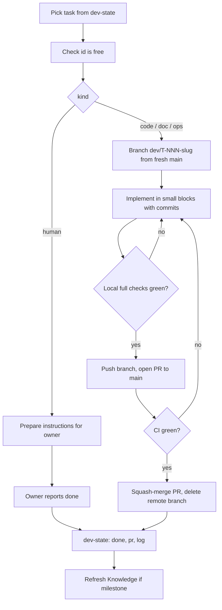

# OnoySan — Working methodology

How one human owner and Claude take OnoySan from idea to store release: a Claude Project in Chat for architecture and review, Claude Code in the desktop Code tab for implementation, GitHub with CI for enforcement. This file merges the generic project methodology (`00_Методология_работы.md` v1.0) and the Claude Code + Claude Projects workflow (`cc-projects-workflow` v1) into one law. Both originals are archived; this file replaces them.

Normative words: "must" and "never" are rules; "should" is a default that may be overridden by a recorded decision.

## 0. Precedence

1. The Project instruction (Chat) and `CLAUDE.md` (Code) — only what is specific to a surface.
2. This file.
3. Other Tier 0 documents (`dna`, `stack`, `invariants-*`, `code-style`).
4. Everything else.

Where a lower document contradicts a higher one, the higher one wins and the contradiction is reported in "Session decisions".

## 1. Principles

1. **One source of truth.** Git (`main`) holds every document, decision, task and line of code. Project Knowledge, exported folders, pages and tables are mirrors. When a mirror and git disagree, git wins and the mirror is refreshed. Edits made in a mirror are first carried into git, then git is authoritative again.
2. **Data separate from view.** A page, board or summary for a human is generated from data and stores nothing of its own. Change the data, not the layout.
3. **Stable core.** Tier 0 documents change rarely and only through an ADR. `docs/INDEX.md` keeps a content hash per document; a session re-reads only documents whose hash changed.
4. **Strict schema, immutable IDs.** Every record has a prefixed ID; the next free ID lives in `next_ids`; IDs are never reused. The schema is checked by `tools/check.py`, not by eye.
5. **Decisions are append-only.** A changed decision is a new ADR that references and supersedes the old one. The history shows why the product is the way it is.
6. **Owner words are unambiguous commands** (section 6). Claude never guesses intent.
7. **Scripts instead of tokens.** Counting, reconciling, exporting, checking IDs and dates is done by a script; Claude reads its short output. A repeated manual action gets a script in `tools/` first.
8. **Two forms of the same data.** Humans get readable documents; another model gets compact YAML with only the needed fields. No model parses HTML or formatted documents when YAML exists.
9. **Least authority.** The agent gets exactly the capabilities of one repository. Keys are used, never handed over. Server-side enforcement (ruleset, CI) beats client-side configuration.
10. **Evidence over memory.** External versions, APIs, prices and policies come from a search with source and date. Unverifiable values are placeholders marked "verify at adoption". Non-trivial claims carry a confidence level: High, Medium or Low.

## 2. Scope

Apply to OnoySan for its whole life: from documentation consolidation to public release in the App Store and Google Play, and after.

Assumptions this file is built on:

- one human owner approves every decision; Claude never approves for him;
- the owner works on Windows; development runs inside WSL 2;
- the repository is hosted on GitHub; CI is GitHub Actions;
- default stack is Rust (Cargo workspace) with PostgreSQL; stack-specific rules are marked "Rust profile".

If any assumption stops being true, this file is revised through an ADR before work continues.

## 3. Roles and surfaces

### 3.1 Actors

| Actor | Does | Never does |
|---|---|---|
| Owner | Sets goals, answers questions, approves with owner words, owns credentials, accounts, money and the ruleset, performs `human` tasks | Pastes secrets into any chat or file |
| Chat Project ("architect") | Architecture, review of PRs, ADR drafts, task specs (Tier 4), document drafts, stage planning | Treats Knowledge as the source; edits code; approves |
| Claude Code ("implementer") | Implements `code`, `doc` and `ops` tasks, runs checks, commits, pushes, opens and merges PRs when green, updates dev-state | Changes rules without approval; force-pushes; pushes to `main`; reads keys or tokens |
| CI and ruleset | Enforce format, lint, tests, branch protection | — |

### 3.2 Sources of truth

```yaml
master_copy: git repository, branch main — documents, decisions, tasks, code
session_memory: docs/dev-state.yaml
decisions: docs/decisions/ADR-NNN-<slug>.md plus approvals in dev-state
agent_instructions: CLAUDE.md at the repository root
document_index: docs/INDEX.md (generated by tools/gen-index, never hand-edited)
mirrors:
  - Chat Project Knowledge — refreshed at milestones (section 13)
  - Windows export folder — optional, generated by git hooks (Appendix G)
archive: archive/concept-docs-ru/ in the repository — original Russian sources (status archived, read-only, never edited)
```

### 3.3 Environment

```yaml
host: Windows 10/11
development: WSL 2 distribution (Ubuntu), Claude Code desktop app, Code tab, session environment "WSL"
repository_path: ~/dev/projects/onoysan inside the distribution file system
never:
  - repository on G:\ (Google Drive) or any synced cloud folder — non-atomic sync corrupts .git; target/ is gigabytes
  - repository on /mnt/c — network file system, slow, breaks file watching
backup:
  code_and_documents: GitHub
  build_output_caches_local_settings: none — they stay in WSL and are disposable (.gitignore)
```

Why WSL and not a Local Windows session: the Claude Code sandbox runs on macOS, Linux and WSL 2; native Windows is not supported (confidence High, Claude Code sandboxing documentation, checked 2026-11-15). Without the sandbox, section 11 cannot be enforced.

Code tab caveat (confidence Low, third-party issue reports): desktop sessions may not apply every key of a project-level `settings.local.json`. At adoption, open `/sandbox` inside a Code tab WSL session and confirm on the Config tab that the denied paths and the network allowlist are active. If they are not, run Claude Code from the WSL terminal for this repository until fixed.

## 4. Work model

### 4.1 Cascade

Goal → Stage → Task. A task belongs to exactly one stage. Documents are identified by their own document id (section 9), not by a task-style ID.

```yaml
goal:      # G-NNN — why the whole effort exists
  fields: [id, name, why, scope, status]
  why: lever and the condition under which the goal stops being relevant
  status: [Not started, In progress, Paused, Done]
stage:     # S<n> — a bounded project with an end
  fields: [id, name, point, exit_criterion, status]
  status: [planned, active, blocked, done]
task:      # T-NNN — one action, one result
  fields: [id, name, stage, kind, priority, urgency, status, assignee, blocked_by, due, branch, pr, next_step]
  kind: [code, doc, ops, human]
  status: [todo, in_progress, blocked, review, done]
  assignee: [owner, claude-code, chat]
question:  # Q-NNN
  fields: [id, question, blocks, asked, answer]
decision:  # ADR-NNN — file in docs/decisions, single numbering for the whole product
```

Task kinds:

- `code` — changes source; branch and PR required.
- `doc` — changes documents only; branch and PR required.
- `ops` — infrastructure or configuration done by Claude Code with approval (DNS records, CI settings in files, cloud resources through code); a PR if files change.
- `human` — only the owner can do it (legal entity, payments, store accounts, domain purchase, key creation). Claude prepares instructions; the owner reports completion; Claude marks it done.

### 4.2 Rules

1. **Point** of a stage: `[artifact] + [final state]`, no process verbs ("improve", "work on", "research"). Exit criterion: a check anyone can run.
2. **Atomic task:** one action, one result, one working session (30 minutes to one day), no waiting inside. "Send and wait for an answer" is two tasks, the second `blocked_by` the first.
3. No checklists inside a task and no splitting below need: two consecutive steps by the same actor without a pause are one task. Norm: 5–20 tasks per stage; more than 25 means the stage is split.
4. `blocked_by` only for a physical dependency. No cycles; the first task of a stage is unblocked; a task's due date is not earlier than its blocker's.
5. No recurring tasks and no routine trackers. Long work is cut into time boxes.
6. **Priority:** P1 — no Point without it · P2 — strongly affects quality · P3 — useful · P4 — removable. **Urgency:** U1 — today or tomorrow, or blocks others · U2 — this week · U3 — within the stage · U4 — someday. A task blocking two or more others is U1 or U2.
7. Dates: `DD.MM.YYYY`, time `DD.MM.YYYY HH:MM`. Without a calendar date: `D+N` from stage start. Machine dates in logs and headers: `YYYY-MM-DD`.
8. Unknown parent goal: `[clarify]`. Unclear stage result: one question before decomposition.
9. Knowledge (a conclusion, principle, reference) is not a task; it goes into a document.
10. Task names start with an imperative verb: "Create", "Translate", "Register".

### 4.3 Stage map: idea to stores

Proposed map. Stage 1 confirms or changes it with an ADR. Only S0 is active.

| Stage | Point (artifact + final state) |
|---|---|
| S0 Foundation | Repository with CLAUDE.md, CI, ruleset, dev-state and the full English document set by tier; Russian sources in `archive/`, nothing project-related left on Google Drive |
| S1 Product definition | MVP scope document with user flows and acceptance criteria accepted by ADR; store and payment policy check recorded |
| S2 Architecture and skeleton | Tier 0 `dna`, `stack`, `invariants-*` accepted; workspace skeleton compiles; database migrations run in CI |
| S3 Ledger core | PL/pgSQL ledger with invariant tests green in CI |
| S4 Cognitive gateway and Telegram | Message-to-ledger round trip through the bot works end to end on staging |
| S5 Clients | PWA and mobile apps on staging against the same core |
| S6 Hardening | Security review closed, observability live, privacy and terms published, account deletion works |
| S7 Closed beta | Cohort uses production; exit metrics recorded |
| S8 Store release | Apps approved and public in the App Store and Google Play |

Release gates that cross stages:

- Store developer accounts and bundle id `com.onoysan.app` require the legal entity (ADR-030 §7.3); the bundle id is irreversible after first publication.
- The no-in-app-purchase rule (INV-BILL-01) must be checked against current App Store Review Guidelines and Google Play payments policy in S1, before any client work. Confidence that the current design passes review as is: Low. Verify at adoption.
- Privacy policy, terms, data deletion, `security.txt` must exist before S7.

## 5. Session memory: `docs/dev-state.yaml`

One file holds the state that `00_Методология` kept in `data.yaml` and `STATE.md`. Template in Appendix B. It contains: goal, focus, what waits for the owner, the week plan, `next_ids`, stages, tasks, open questions, approvals and the session log.

Rules:

1. Every new task, question or approval goes into dev-state immediately with the next free ID.
2. Before using an ID, check it is free: not in dev-state, not in `docs/decisions/`, not in a branch name (`git branch -a`). `python3 tools/check.py --git` does this.
3. `tools/check.py` must pass before dev-state is committed (Appendix H).
4. dev-state is updated at session start (status only if stale), during work, and at session end.

## 6. Owner words

Russian and English forms are equivalent.

| Word | Effect |
|---|---|
| `согласовано` / `approve` | The proposal or the listed "Session decisions" take effect; recorded in `approvals` |
| `согласовано в ADR` / `approve decision` | Accept and record as an ADR in `docs/decisions/` |
| `отклонить: <причина>` / `reject: <reason>` | Proposal withdrawn; reason goes to the log |
| `доработать: <текст>` / `revise: <text>` | Rework per text and show again without repeated questions |
| `пауза` / `pause` | Pause protocol (section 7.3) |
| `стоп` / `Esc` | Immediate stop without protocol; next session starts with a consistency check of `git status` and dev-state |
| `merge` | Explicit permission to merge a PR that needs human sign-off |

Any change to rules, contracts, layers, invariants or this file is proposed as a "Session decisions" list at the end of an answer and takes effect only after an approval word for it.

## 7. Session lifecycle

### 7.1 Start

Chat Project:

1. If the export folder is connected, read `_sync/changes.json`; re-read only `added` and `modified`. If the file is missing or `schema` is unknown, re-read everything and say so.
2. Read dev-state from the mirror.
3. First line of the answer: stage and next tasks, for example `S0; next: T-004 (in progress), T-005`.

Claude Code:

1. In a WSL terminal, if pushes are expected: `eval "$(ssh-agent -s)"` (only if none is running), `ssh-add -t 8h ~/.ssh/onoysan-deploy`.
2. Open a Code tab session with environment WSL and folder `~/dev/projects/onoysan`.
3. Read `CLAUDE.md` and `docs/dev-state.yaml`. First line: stage and next tasks.
4. `git status` and `git fetch` as separate calls; report a dirty tree or a branch behind origin before acting.
5. `python3 tools/check.py`; report errors before acting.

### 7.2 Work

- Small blocks: one logical change, compiles, its tests pass, commit.
- Fast loop per crate (Rust profile: `cargo test -p <crate>`); full workspace checks before any commit handed off for push.
- New tasks, questions, decisions go to dev-state at once.
- Work that depends on an unapproved decision waits.

### 7.3 Pause

On `пауза` / `pause`:

1. Finish the current block until it compiles and its tests pass; do not start a new one.
2. Run full local checks.
3. Commit; if not green, prefix the message with `wip:` and list what fails.
4. Update dev-state: task status, exact next step, open questions, log entry.
5. Report in at most five lines: done, not green, next step.

### 7.4 End

1. Finished blocks committed; branch pushed or PR merged per section 8.
2. dev-state updated: tasks, open questions, waiting on owner, log.
3. Session summary: merged PRs (number, title, task id — mandatory even if empty), open PRs, next tasks, pending approvals, what waits for the owner.
4. If a milestone was reached: Knowledge refresh (section 13).

### 7.5 Resume

`claude --continue` or `claude --resume` in the terminal, or reopening a Code tab session, does not replace reading dev-state: re-read it and restate the one-line status.

## 8. Task lifecycle



Rules:

1. One task = one branch `dev/<task-id>-<slug>` = one PR into `main`. Slug: lowercase, hyphenated, at most five words.
2. Branch from an up-to-date `main`: `git fetch`, then `git switch -c dev/T-NNN-<slug> origin/main`.
3. Claude Code pushes, opens and merges the PR itself only when local checks and CI are green. Merge method: squash.
4. Never force-push; never push directly to `main`; never use admin bypass.
5. CI failure is fixed on the same branch with new commits; history is not rewritten after push.
6. After merge: task `status: done`, `pr: <number>`, log entry.
7. PR description: task id, summary, touched crates or documents, invariants referenced, "Session decisions" if any.
8. A PR that changes Tier 0, a contract or an invariant waits for `merge` from the owner even when green.

## 9. Documents

### 9.1 Tiers

| Tier | Documents | Changes when |
|---|---|---|
| 0 | `README`, `workflow` (this file), `stack`, `dna`, `code-style`, `invariants-<area>`, `INDEX` (generated) | Rarely; through an ADR |
| 1 | `BLUEPRINT` | Scope or architecture shifts |
| 2 | `vision-<topic>` | A subsystem's intent changes |
| 3 | `arch-<crate>`, one per crate | Contract or internals change |
| 4 | `spec-<task-id>` | Per task |
| 5 | `ADR-NNN-<slug>` | Per decision; append-only after acceptance |

Product and brand documents (branding, naming, legal, store listings) live in `docs/product/` with the same header and are indexed like any other document.

### 9.2 Header

```yaml
id: arch-onoy-core
tier: 3
role: arch            # law | arch | vision | spec | decision | reference | product
status: active        # draft | active | superseded | archived
version: 1
updated: YYYY-MM-DD
owner: Chyntemir
layer: core           # Tier 3 only, from dna
crate: onoy-core      # Tier 3 only
contract_version: 1   # Tier 3 only
security: none        # Tier 3 only: none | handles-secrets | external-io | untrusted-input
```

Rules:

1. Every content change: `version` + 1 and `updated` refreshed.
2. The content hash in INDEX is sha256 of the file with the `updated:` and `status:` lines removed, so status flips do not look like content changes.
3. `docs/INDEX.md` is generated by `tools/gen-index` (id, tier, version, status, hash); never hand-edited.
4. A superseded document keeps its id, gets `status: superseded` and `superseded_by:`.

### 9.3 Format and language

- Documents, code, comments, identifiers and commit messages: English. Chat with the owner: Russian. Russian costs roughly 1.5–2 times more tokens per word than English, and Tier 0–3 documents are re-read every session.
- User-facing strings (Russian, Kyrgyz, English and later languages) live in localization files, not in documents.
- No ASCII art or box-drawing characters; Mermaid only for graphs, otherwise YAML.
- No alignment padding; tables only when dense, otherwise lists or YAML.
- Machine data in YAML or TOML unless an external format requires JSON.
- No cryptic abbreviations; spell terms out on first use.
- A fact not present in the files is never invented: `[needs data]` and one line on what is needed.

### 9.4 Resolving conflicts between sources

When two documents contradict each other, the most recent one wins. Recency is taken only from a date inside the document (`updated`, otherwise `created`, otherwise a `Timestamp` line in chat transcripts), never from file modification time: the Stage 0 sources were all exported on 2026-11-15. A source without a date is marked `[needs date]` and listed for the owner. The conflict is never resolved silently: name both documents, which one won and why.

## 10. Code rules

### 10.1 Modules and layers

1. One module = one crate in the workspace (Rust profile; other stacks: one package with an explicit public interface).
2. `dna` defines layers and allowed dependency direction: downward only, no cycles.

```yaml
layers:
  - name: core
    may_depend_on: []
    io: false
  - name: adapters
    may_depend_on: [core]
    io: true
  - name: app
    may_depend_on: [core, adapters]
    io: true
    note: wiring only
```

3. A crate exposes as `pub` only what its `arch-<crate>` "Public contract" section lists.
4. A contract change goes through an ADR, `contract_version` + 1, and every dependent crate's arch document is revisited in the same PR or a linked follow-up task.
5. Dependency direction is checked mechanically (Rust profile: a test over `cargo metadata` that fails on a forbidden edge).
6. Library errors with `thiserror`; no `todo!()` or `unimplemented!()` in merged code.

### 10.2 Invariants and markers

- Invariants have ids `INV-<area>-NN` and live in `docs/tier-0/invariants-<area>.md`.
- Code references them: `// inv: INV-LEDGER-01 — wallets equal envelopes` and `// ref: arch-onoy-core#public-contract`.
- A removed invariant keeps its id with `status: retired`; ids are never reused.
- A PR that weakens an invariant is a blocking review finding regardless of CI.

### 10.3 Local checks (Rust profile)

```yaml
fast: cargo test -p <crate>
before_push:
  - cargo fmt --all --check
  - cargo clippy --workspace --all-targets --all-features -- -D warnings
  - cargo test --workspace --all-features
  - python3 tools/check.py
database: migrations and PL/pgSQL tests run against a disposable PostgreSQL in CI (service container); locally against a container or a WSL PostgreSQL, never against shared data
```

## 11. Security model

### 11.1 Principles

1. Least authority: the agent gets one repository; nothing account-wide.
2. Keys are used, not handed over: the SSH key stays in `ssh-agent`; the agent never reads key material or token files.
3. Server-side enforcement beats client-side configuration: the GitHub ruleset holds even if local settings are wrong.
4. Code that runs outside the sandbox is never writable by the agent.
5. Production credentials never touch the development machine; staging uses its own credentials and `onoysan.dev` (ADR-030 §6).

### 11.2 What runs where

| Path | Runs | Can | Cannot |
|---|---|---|---|
| Sandboxed Bash (auto-allowed) | OS sandbox (bubblewrap in WSL 2) | Read most of the machine except denied paths; write the repository, temp dir, `allowWrite` paths; reach `allowedDomains` | Write `.git/hooks`, `.git/config`, `.claude` settings; read denied credential paths; reach other hosts without a prompt |
| Excluded commands | Outside the sandbox, regular permission flow | `git push/pull/fetch`, `gh pr *`, `gh run *` as allowed | Anything matched by `permissions.deny` |
| Read, Edit, Write tools | Outside the sandbox, permission rules | Repository files | Paths matched by `Read(...)` / `Edit(...)` deny rules |
| Git hooks and export script | Context of the git command that fires them | Write the export folder | Be modified by the agent |

Facts verified on 2026-10-25 against the Claude Code sandboxing documentation, confidence High; sandbox platform support re-checked 2026-11-15:

- Default sandbox read access covers the whole machine including `~/.ssh`; credentials must be denied explicitly.
- `excludedCommands` uses `Bash(...)` rule syntax; a pattern needs a trailing ` *` to match arguments.
- Every command in a call must match an exclusion; a redirect, `cd` or command substitution keeps the whole call sandboxed.
- Built-in Read and Edit tools are not governed by sandbox filesystem rules; they need their own deny rules.
- Writes to `.claude` settings, `.git/hooks` and `.git/config` in the working directory are denied inside the sandbox.
- `allowUnsandboxedCommands: false` disables the retry-unsandboxed escape hatch.
- In WSL 2, sandboxed commands cannot launch Windows binaries (`cmd.exe`, `powershell.exe`, anything under `/mnt/c/`).

### 11.3 Rules

1. Sandbox enabled with auto-allow for sandboxed commands; `allowUnsandboxedCommands: false`.
2. `sandbox.filesystem.allowWrite`: only toolchain directories builds must write (`~/.cargo`; `~/.rustup` only if the agent may update the toolchain) and the export folder if the bridge is used.
3. The export script path is never in `allowWrite` and is covered by an `Edit(...)` deny rule.
4. `sandbox.credentials` denies `~/.ssh`, `~/.config/gh`, cloud credential files, and the variables `SSH_AUTH_SOCK`, `GH_TOKEN`, `GITHUB_TOKEN` for sandboxed commands (confidence Medium for `SSH_AUTH_SOCK`: the socket path may still be reachable by a process that knows it; verify at adoption).
5. Network allowlist: package registries and GitHub only (Rust profile: `crates.io`, `index.crates.io`, `static.crates.io`, `static.rust-lang.org`; add npm, Maven or CocoaPods hosts only when a stage needs them, through an approved decision).
6. Only `git push`, `git pull`, `git fetch`, `gh pr`, `gh run` run outside the sandbox, through `excludedCommands` with matching `permissions.allow`.
7. These commands are standalone calls: no `&&`, `;`, `|`, redirects, `cd`, `$(...)` or environment-variable prefixes.
8. `permissions.deny` blocks every force-push form, pushes naming `main`, `gh pr merge --admin`, `gh repo *`, `gh api *`, `gh auth *`, `gh secret *`.
9. Secrets are referenced only by environment variable name; never as literals in code, documents, logs, commit messages or chat. Files that would hold secrets are committed only as `*.example` with placeholders; `.gitignore` excludes the real ones.
10. Local deny rules are a convenience layer; the ruleset (Appendix F) is the enforcement layer. If they disagree, the ruleset wins and local settings are fixed.
11. Store signing keys (Android upload keystore, Apple distribution certificates, App Store Connect API key) are `human` assets: created by the owner, stored outside the repository and outside WSL scratch space, injected into CI only as encrypted secrets.

### 11.4 Residual risks

- A sandboxed `git commit` fires `post-commit` inside the sandbox; the export script needs `allowWrite` on the export folder, which the agent can also write by other means. The Chat Project treats that folder as a mirror, never as input that overrides git.
- `gh pr merge` can merge any PR in the repository; mitigated by single-repository scope and required CI.
- A deploy key grants write to all non-protected branches.

## 12. Repository layout

```yaml
onoysan/:
  CLAUDE.md: agent instructions (Appendix A)
  README.md: what the product is, how to build
  Cargo.toml: workspace manifest
  Cargo.lock: committed
  rust-toolchain.toml: pinned toolchain
  .gitignore: build output, caches, local settings, secrets (separate file)
  crates/:
    onoy-<name>/: [Cargo.toml, src/, tests/]
  db/:
    migrations/: ordered SQL migrations
    tests/: PL/pgSQL tests
  apps/: client applications (PWA, mobile) — added in S5
  docs/:
    INDEX.md: generated
    dev-state.yaml: session memory
    tier-0/: [README.md, workflow.md, stack.md, dna.md, code-style.md, invariants-<area>.md]
    tier-1/: [BLUEPRINT.md]
    tier-2/: [vision-<topic>.md]
    tier-3/: [arch-<crate>.md]
    tier-4/: [spec-<task-id>.md]
    decisions/: [ADR-NNN-<slug>.md]
    product/: [branding.md, naming.md, store-listing.md, legal/*.md]
    baseline/: [baseline-<date>.md]
  tools/:
    check.py: dev-state validator (Appendix H)
    gen-index: regenerates docs/INDEX.md and hashes
  .claude/:
    settings.json: shared project settings (optional, committed)
    settings.local.json: sandbox and permissions (Appendix C, not committed)
  .github/workflows/ci.yml: CI (Appendix E)
outside_repo:
  ~/.local/bin/onoysan-export: export script (read-only for the agent, optional)
  ~/.ssh/config: host alias (Appendix D)
```

## 13. Chat Project and Knowledge

1. Knowledge holds: this file, Tier 0–2 documents, accepted ADRs, `docs/INDEX.md`, and dev-state. Russian sources are not put into Knowledge; the Chat Project reads them through the export bridge.
2. Knowledge is refreshed at milestones: a stage closes, an ADR is accepted, a Tier 0–2 document changes, a crate reaches its exit criterion.
3. When Knowledge and git disagree, git wins.
4. Live bridge: git hooks export tracked files to a Windows folder that the Chat Project connects (Appendix G). It is the Chat Project's only view of the repository between Knowledge refreshes, so it is set up in S0. Put that folder on `C:`, not on Google Drive.

## 14. Rhythm

This is a working rule, not tasks in dev-state.

- **Monday:** week plan in dev-state `week_plan`: focus, tasks due this week, what waits for the owner. Takes effect after `согласовано`.
- **Friday:** five-line review in the log: closed, moved, blocking, next week. Overdue tasks get a new due date or are removed.

## 15. Token economy

1. Whatever a script can do, a script does. Claude does not scan records by eye when `tools/` can count or check them.
2. For another model (another Project, an agent): compact YAML with only the needed records and fields, no formatting, no emails, no secrets.
3. Core documents are not re-read without a hash change. Large files are read by section.
4. English for everything a model re-reads (section 9.3).

## 16. Several projects

If work is split later (for example a separate brand or legal Project), the "hub and satellites" scheme applies.

- The hub (this repository and its Chat Project) owns goals, stages, tasks, decisions and issues IDs. A satellite does its heavy work locally and exports only a summary.
- A satellite never creates hub IDs and never edits hub files. New tasks are proposed without IDs.
- A satellite issues a summary when: a hub task closed or moved, a Point or milestone reached, a document for an external party is ready, a decision or unblocking is needed, new tasks are needed, `пауза` was said, or Friday after a working week.

Summary format, YAML only:

```yaml
summary:
  schema: 1
  source: <satellite name>
  period: DD.MM.YYYY – DD.MM.YYYY
  author: <role>
  stage: S1
  progress: One or two sentences.
  task_updates: [{id: T-012, status: done}]           # only status, due, assignee
  new_tasks: [{name: Verb and result, kind: doc, priority: P2, urgency: U3, due: D+2, blocked_by: [T-012]}]
  documents: [{id: <doc-id>, status: active, file: <path>}]
  decisions_proposed: [what to approve]
  questions: [question for the owner]
  blockers: [what blocks]
  next: [next step]
```

The hub applies a summary by script: validate, assign IDs, log line, copy to `docs/inbox/`. Proposed decisions take effect only after an owner word in the hub.

## 17. Changes to this file

1. Changed only through a "Session decisions" proposal and `согласовано в ADR`.
2. New version: `version` + 1, `updated`, changelog entry below; the previous text stays in git history.
3. Tier 0 documents that conflict with a new version are updated in the same PR or a linked task.

## 18. Never

- Invent facts, numbers, versions, deadlines, statuses or policies.
- Keep the same data in two places.
- Parse HTML or formatted documents when data exists.
- Create reminder tasks or routine trackers.
- Put the repository on a synced cloud drive.
- Write secrets into files, commits, logs or chat.

## 19. Limitations

This manual setup does not provide, and must not be described as providing:

- A state machine and quality gates executed by code. Partially replaced by CI, the ruleset and the pause and approval protocols, which depend on discipline.
- Deterministic context assembly. Claude Code manages its own context; results are not reproducible bit for bit.
- Model routing by cost class, budgets, an independent auditor on another provider. Review is done by the same model family in the Chat Project.
- A cost ledger. Baselines (Appendix I) are the substitute.

---

## Appendix A. CLAUDE.md template

```markdown
# CLAUDE.md — onoysan

Law: docs/tier-0/workflow.md. This file only lists what Claude Code needs every session.

## Session start
1. Read docs/dev-state.yaml. First line of output: stage and next tasks, one line.
2. Run `git status` and `git fetch` as separate calls; report a dirty tree or a branch behind origin before acting.
3. Run `python3 tools/check.py`; report errors before acting.

## Sources of truth
- Git is the master copy. Project Knowledge is a mirror.
- Rules: docs/tier-0/*. Architecture: docs/tier-1, docs/tier-2, docs/tier-3/arch-<crate>.md.
- Rule changes go to "Session decisions" at the end of the answer and wait for `согласовано` / `approve`.

## Tasks
- One task = one branch `dev/T-NNN-<slug>` = one PR into main.
- Check a T-NNN or Q-NNN id is free (`python3 tools/check.py --git`) before using it.
- Small blocks; commit after each finished logical block.
- Fast loop: `cargo test -p <crate>`. Before any commit handed off for push: `cargo fmt --all --check`, `cargo clippy --workspace --all-targets --all-features -- -D warnings`, `cargo test --workspace --all-features`, `python3 tools/check.py`.
- Push, open and merge the PR yourself only when local checks and CI are green. Merge method: squash. PRs touching Tier 0, contracts or invariants wait for `merge`.
- Never force-push. Never push to main. Never use admin merge.
- `human` tasks: prepare exact instructions for the owner; never perform them.

## Commands outside the sandbox
- `git push`, `git pull`, `git fetch`, `gh pr ...`, `gh run ...` must be standalone calls: no `&&`, `;`, `|`, redirects, `cd`, `$(...)` or env-var prefixes.

## Owner words
согласовано/approve · согласовано в ADR/approve decision · отклонить/reject · доработать/revise · пауза/pause · стоп/Esc · merge.

## Pause
On `пауза` / `pause`: finish the current block (compiles, tests pass), run checks, commit (`wip:` plus what is not green if needed), update dev-state with the next step, report in at most five lines.

## Code
- `pub` only what arch-<crate> "Public contract" lists. Dependencies downward only per docs/tier-0/dna.md.
- Financial math only in PL/pgSQL; Rust calls procedures and maps results (INV-LOGIC-01).
- Errors with thiserror; no `todo!()` or `unimplemented!()` in merged code.
- Comments reference invariants and documents: `inv: INV-<area>-NN`, `ref: <doc-id>#<section>`.
- Secrets only by environment variable name. Never use the word "sana" in new identifiers.

## Documents
- English; YAML header; version + 1 on every content change; regenerate docs/INDEX.md with tools/gen-index.
- External versions, APIs and policies only from a search with source and date; otherwise "verify at adoption".

## Session end
Update dev-state (tasks, open_questions, waiting_on_owner, log). Summary lists merged PRs (number, title, task id; mandatory even if empty), open PRs, next tasks, pending approvals.
```

## Appendix B. `docs/dev-state.yaml` template

```yaml
id: dev-state
role: memory
version: 1
updated: YYYY-MM-DD
goal:
  id: G-001
  name: <goal>
  why: <lever; condition under which the goal is no longer relevant>
  scope: <deadline or period>
  status: In progress          # Not started | In progress | Paused | Done
focus: <one line: current stage and main thing>
waiting_on_owner:
  - <what the owner must do or answer>
week_plan:
  week: DD.MM.YYYY – DD.MM.YYYY
  approved: false
  items: [T-001]
next_ids:
  task: T-001
  question: Q-001
  adr: ADR-031                 # single product series; ADR-030 is the rename decision
stages:
  - id: S0
    name: Foundation
    point: <artifact + final state>
    exit_criterion: <check anyone can run>
    status: active             # planned | active | blocked | done
tasks:
  - id: T-001
    name: <imperative verb + result>
    stage: S0
    kind: code                 # code | doc | ops | human
    priority: P1               # P1..P4
    urgency: U1                # U1..U4
    status: todo               # todo | in_progress | blocked | review | done
    assignee: claude-code      # owner | claude-code | chat
    blocked_by: []
    due: D+1                   # DD.MM.YYYY | DD.MM.YYYY HH:MM | D+N
    branch: dev/T-001-<slug>   # code and doc tasks
    pr: null
    next_step: <exact next action>
open_questions:
  - id: Q-001
    question: <text>
    blocks: [T-001]
    asked: YYYY-MM-DD
    answer: null
approvals:
  - date: YYYY-MM-DD
    word: согласовано          # or approve, согласовано в ADR, approve decision
    subject: <decision summary>
    adr: null
log:
  - date: YYYY-MM-DD
    session: <short label>
    merged_prs: []             # list of {number, title, task}; mandatory, may be empty
    summary: <one or two lines>
```

`next_ids` is a hint, not a guarantee: `tools/check.py --git` verifies it.

## Appendix C. `.claude/settings.local.json` template

JSON is required by Claude Code. Rule syntax and keys verified 2026-10-25 against the Claude Code sandboxing documentation (confidence High for documented keys; the force-push deny patterns are this file's choice and must be tested in Manual mode at adoption).

```json
{
  "sandbox": {
    "enabled": true,
    "autoAllowBashIfSandboxed": true,
    "allowUnsandboxedCommands": false,
    "excludedCommands": [
      "git push *",
      "git pull *",
      "git fetch *",
      "git fetch",
      "git pull",
      "gh pr *",
      "gh run *"
    ],
    "filesystem": {
      "allowWrite": [
        "~/.cargo",
        "/mnt/c/Users/<win-user>/onoysan-export"
      ],
      "denyWrite": [
        "~/.local/bin/onoysan-export"
      ]
    },
    "credentials": {
      "files": [
        { "path": "~/.ssh", "mode": "deny" },
        { "path": "~/.config/gh", "mode": "deny" }
      ],
      "envVars": [
        { "name": "SSH_AUTH_SOCK", "mode": "deny" },
        { "name": "GH_TOKEN", "mode": "deny" },
        { "name": "GITHUB_TOKEN", "mode": "deny" }
      ]
    },
    "network": {
      "allowedDomains": [
        "crates.io",
        "index.crates.io",
        "static.crates.io",
        "static.rust-lang.org"
      ]
    }
  },
  "permissions": {
    "allow": [
      "Bash(git push -u origin dev/*)",
      "Bash(git push origin dev/*)",
      "Bash(git pull *)",
      "Bash(git pull)",
      "Bash(git fetch *)",
      "Bash(git fetch)",
      "Bash(gh pr create *)",
      "Bash(gh pr view *)",
      "Bash(gh pr checks *)",
      "Bash(gh pr merge *)",
      "Bash(gh pr list *)",
      "Bash(gh run list *)",
      "Bash(gh run view *)",
      "Bash(gh run watch *)"
    ],
    "deny": [
      "Bash(git push --force *)",
      "Bash(git push * --force *)",
      "Bash(git push * --force)",
      "Bash(git push -f *)",
      "Bash(git push * -f *)",
      "Bash(git push * -f)",
      "Bash(git push *--force-with-lease*)",
      "Bash(git push *--force-if-includes*)",
      "Bash(git push *--mirror*)",
      "Bash(git push *--delete*)",
      "Bash(git push * -d *)",
      "Bash(git push *+*)",
      "Bash(git push * :*)",
      "Bash(git push * main)",
      "Bash(git push * main:*)",
      "Bash(git push * HEAD:main)",
      "Bash(gh pr merge *--admin*)",
      "Bash(gh repo *)",
      "Bash(gh api *)",
      "Bash(gh auth *)",
      "Bash(gh secret *)",
      "Read(~/.ssh/**)",
      "Read(~/.config/gh/**)",
      "Edit(~/.local/bin/onoysan-export)",
      "Edit(~/.ssh/**)",
      "Edit(~/.zshenv)",
      "Edit(~/.bashrc)"
    ]
  }
}
```

Notes:

- Read and Edit rules use `~/` for home and `//` for absolute paths; sandbox filesystem paths use `~/` and plain absolute paths. Do not mix the conventions.
- After editing, open `/sandbox` in a Code tab WSL session, check the Config tab, and test one denied push form in Manual mode.

## Appendix D. `~/.ssh/config` host alias

```text
Host github-onoysan
  HostName github.com
  User git
  IdentityFile ~/.ssh/onoysan-deploy
  IdentitiesOnly yes
  AddKeysToAgent no
```

Remote URL: `git@github-onoysan:onoysan/<repo>.git`. The key is added manually per session with `ssh-add -t 8h`.

## Appendix E. CI workflow skeleton

Action versions checked 2026-10-25: `actions/checkout` v7.0.1; `Swatinem/rust-cache` v2.9.3; `dtolnay/rust-toolchain` by branch `@stable`. Verify at adoption and pin each action to a full commit SHA with the version in a trailing comment. The PostgreSQL service and its image tag are placeholders until S2: verify at adoption.

```yaml
name: ci

on:
  pull_request:
  push:
    branches: [main]

permissions:
  contents: read

concurrency:
  group: ci-${{ github.ref }}
  cancel-in-progress: true

env:
  CARGO_TERM_COLOR: always
  RUSTFLAGS: -D warnings

jobs:
  check:
    name: check
    runs-on: ubuntu-latest
    steps:
      - uses: actions/checkout@v7          # verify at adoption; pin SHA
      - uses: dtolnay/rust-toolchain@stable
        with:
          components: rustfmt, clippy
      - uses: Swatinem/rust-cache@v2       # verify at adoption; pin SHA
      - name: dev-state
        run: python3 -m pip install pyyaml && python3 tools/check.py
      - name: format
        run: cargo fmt --all --check
      - name: lint
        run: cargo clippy --workspace --all-targets --all-features -- -D warnings
      - name: test
        run: cargo test --workspace --all-features
  # From S2: add a job with a PostgreSQL 16 service container that runs db/migrations and db/tests.
```

During S0, before any crate exists, the `format`, `lint` and `test` steps are skipped with `if: hashFiles('Cargo.toml') != ''`. The job name `check` is the required status check in Appendix F.

## Appendix F. GitHub ruleset

```yaml
name: protect-main
enforcement: active
bypass_list: []                # empty; not even repository admins
target_branches: [default branch]
rules:
  restrict_deletions: true
  block_force_pushes: true
  require_linear_history: true
  require_pull_request:
    required_approvals: 0      # single-owner project
    dismiss_stale_approvals: true
    require_conversation_resolution: true
    allowed_merge_methods: [squash]
  require_status_checks:
    strict: true
    checks: [check]
verify_after_setup:
  - direct push to main from the agent is rejected
  - force-push to main is rejected
  - PR with failing CI cannot be merged
```

The required status check must have run at least once to be selectable. Field names follow the GitHub web interface at the time of writing; verify at adoption.

One-time setup (owner, `human` tasks):

1. Create the repository in the GitHub organization `onoysan`; push an initial `main` with CI; configure the ruleset.
2. Deploy key: `ssh-keygen -t ed25519 -f ~/.ssh/onoysan-deploy -C "onoysan deploy key"`; add the public key with write access; add the host alias; `git remote set-url origin git@github-onoysan:onoysan/<repo>.git`; test with `ssh -T git@github-onoysan`.
3. GitHub CLI token: fine-grained, only this repository; Contents read and write, Pull requests read and write, Actions read. Log in without echoing it: `powershell.exe -NoProfile -Command Get-Clipboard | tr -d '\r\n' | gh auth login --with-token`, then clear the clipboard: `powershell.exe -NoProfile -Command Set-Clipboard -Value $null`. Check with `gh auth status`. Never paste the token into a chat or a file.
4. Shell: PATH and toolchain homes in the non-interactive startup file (`~/.zshenv` for zsh, the `BASH_ENV` target for bash): `CARGO_HOME`, `RUSTUP_HOME`, `PATH`.
5. Sandbox dependencies in WSL: `sudo apt install bubblewrap socat python3-yaml`.
6. `.claude/settings.local.json` from Appendix C; confirm with `/sandbox`.

## Appendix G. Export bridge

The Chat Project cannot read WSL paths (`\\wsl.localhost\...` cannot be connected). The bridge gives it a read-only mirror of tracked files:

```yaml
invocation:
  hooks: [post-commit, post-merge, post-checkout]   # in .git/hooks, never via core.hooksPath into a tracked directory
  hook_body: "~/.local/bin/onoysan-export /mnt/c/Users/<win-user>/onoysan-export >/dev/null 2>&1 || true"
  exit_behaviour: never fails the git command; errors appended to <export>/_sync/export.log with timestamp
inputs:
  file_list: "git ls-files -z" (tracked files only)
  commit: "git rev-parse HEAD"
  branch: "git rev-parse --abbrev-ref HEAD"
  dirty: "git status --porcelain --untracked-files=no" non-empty
exclusions:
  always: ["_sync/**"]
  secret_patterns: ["**/.env", "**/.env.*", "**/*.pem", "**/*.key", "**/id_*", "**/*.p12", "**/*.pfx", "**/*.jks", "**/*.keystore", "**/*.p8", ".claude/settings.local.json"]
  behaviour: excluded paths are logged by name only, never copied
algorithm:
  - load previous _sync/manifest.json if present
  - for each tracked, non-excluded file compute sha256
  - copy new or changed files; preserve relative paths
  - delete mirror files no longer tracked or now excluded
  - write manifest.json and changes.json atomically (temp file, then rename)
  - idempotent: a second run with no changes yields empty added, modified and deleted lists
concurrency: lock file in _sync; a stale lock older than 10 minutes is replaced
script: installed outside the repository, mode 0555, owned by the owner
```

`_sync/changes.json`:

```json
{
  "schema": 1,
  "generated_at": "2026-11-15T12:00:00Z",
  "commit": "<sha>",
  "previous_commit": "<sha or null>",
  "branch": "<branch>",
  "dirty": false,
  "added": [],
  "modified": ["docs/dev-state.yaml"],
  "deleted": []
}
```

`_sync/manifest.json` has the same `schema`, `generated_at`, `commit`, `branch` fields plus `files: {<path>: <sha256>}`.

Reading rule for the Chat Project: read `changes.json`; if `commit` differs from the last one seen, re-read only `added` and `modified`; drop `deleted` from working memory; if the file is missing or `schema` is unknown, re-read everything and say so.

## Appendix H. `tools/check.py`

Shipped as a separate file in `tools/`. It validates `docs/dev-state.yaml`:

- required keys, date formats, enumerations (stage, task and goal statuses, kinds, assignees, priorities, urgencies);
- ID prefixes and uniqueness; `next_ids` ahead of every used ID, including ADR files in `docs/decisions/`;
- each task points to an existing stage; every blocker exists; no `blocked_by` cycles; a task is not due before its blocker; a task blocking two or more others has urgency U1 or U2; `blocked` status has a blocker or an open question;
- branch names `dev/T-NNN-<slug>` match their task; finished `code` and `doc` tasks have a PR;
- every log entry has `merged_prs`;
- with `--git`: every `dev/T-NNN-*` branch, local or remote, belongs to a task in dev-state and is below `next_ids.task`.

Exit code 0 when clean, 1 on errors, 2 when the file is missing or unreadable. Requires PyYAML.

## Appendix I. Baseline

On two or three real tasks per stage record wall time, cost (tokens or money), number of manual owner actions and number of rework loops in `docs/baseline/baseline-<date>.md`. Repeat after any process change to know whether it paid off.

```yaml
tasks:
  - id: T-NNN
    wall_time_minutes: <n>
    cost: <amount and unit>
    manual_actions: <n>
    rework_loops: <n>
    notes: <text>
```

## Changelog

```yaml
- version: 1
  date: 2026-11-15
  change: >
    Merged 00_Методология_работы.md v1.0 and cc-projects-workflow v1.
    Single state file (dev-state) replaces data.yaml and STATE.md; tasks use T-NNN, stages S<n>;
    Russian and English owner words; WSL Code tab environment; idea-to-stores stage map;
    task kinds code, doc, ops, human; conflict rule by in-document date; tools/check.py.
```
